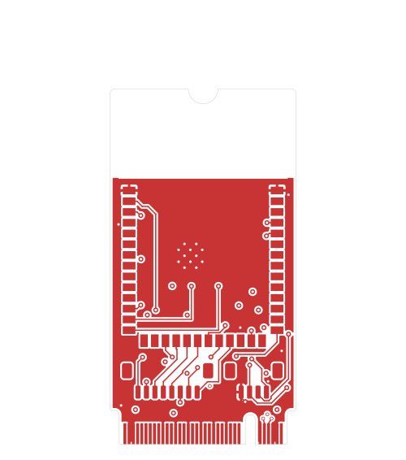
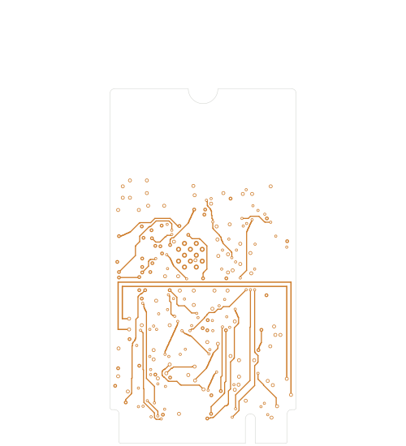
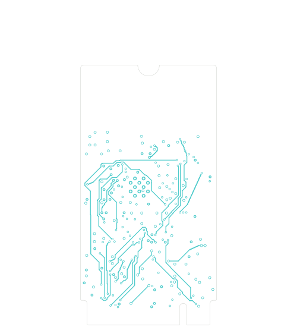
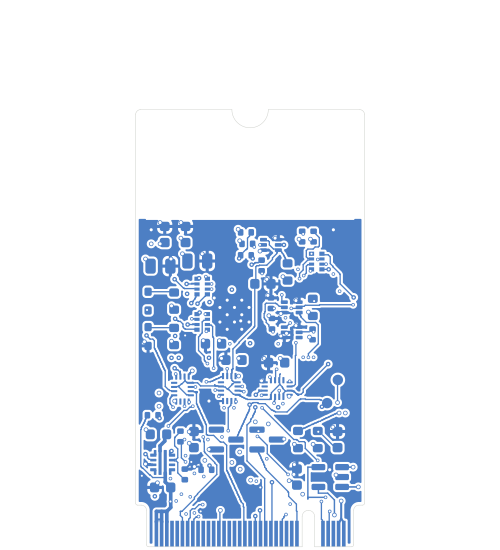
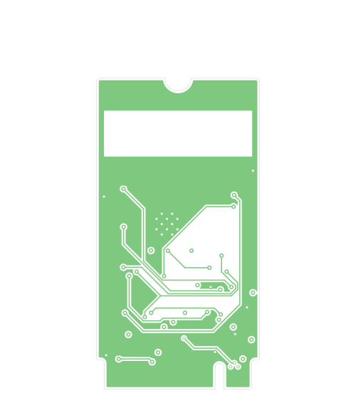
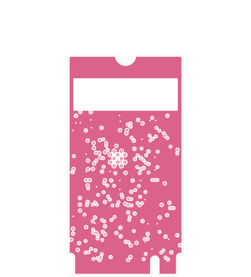

# Layer stackup & routing

> **This branch is v2.0 Rev A: 6 layers, JLC06081H-2116** — see
> [the v2 section](#v20-rev-a--6-layers-jlc06081h-2116-adr-0008-gate-v3-2026-10-07)
> at the end. The 4-layer description below is the ordered **rev B** (history);
> its layer images are served from the `rev-b` branch.

4-layer, 0.8 mm, **SIG / GND / PWR / SIG** — JLCPCB **JLC04081H-3313** stackup.
Layer renders below are generated from the routed board
(`hardware/kicad/esp32_m2_companion.kicad_pcb`); regenerate with `make render`
plus the per-layer export in `docs/`. Blue = copper.

## Stackup (top → bottom)

| # | Layer | Copper | Role | Notes |
|--:|---|---|---|---|
| 1 | **F.Cu** (top) | 1 oz | Signal + components | Module, JST connectors; short signal runs. Prepreg **3313, 0.0994 mm, εr 4.1** to L2 → sets the USB microstrip impedance |
| 2 | **In1.Cu** | 0.5 oz | **Solid GND plane** | Continuous reference for the USB pair; the reason the diff pair is clean. Core (NP-155F) below |
| 3 | **In2.Cu** | 0.5 oz | **+3V3 power plane** | Card 3.3 V rail (post-ferrite); every +3V3 pad vias to here |
| 4 | **B.Cu** (bottom) | 1 oz | Signal + components | Most routing; all passives, USBLC6, diodes, LEDs, test points |

- Board thickness **0.8 mm** (M.2 requirement).
- **USB pair** `USBH3_D_P/N` / `USB_D_P/N`: 90 Ω differential, **0.14 mm width /
  0.14 mm gap**, routed on the outer layers referenced to the L2 GND plane, no
  stubs (SPEC §6.3).
- **At order: Specify Stackup = `JLC04081H-3313`** (Standard, 0.80 mm, prepreg
  3313 RC57% 0.0994 mm) — *not* the 7628 default (thicker 0.72 mm "Special"
  stack). Specifying the stackup pins the 0.0994 mm prepreg, which is what sets
  the pair impedance.
- **Impedance Control QC option: left OFF** (JLC charges ~€28). The ESP32-S3 USB
  is Full-Speed (12 Mbps) only, so controlled impedance is not functional here;
  the paid option only buys a TDR measurement, not a different board.
- **Verified 2026-08-30** against JLCPCB's live impedance calculator: on
  JLC04081H-3313, 90 Ω differential (5.5 mil gap) → **5.2 mil (0.132 mm) width**.
  Our 0.14 mm traces give ~88 Ω (inside a ±10 % window) — no board change.

## The four copper layers

### 1 — F.Cu (top signal)

Component pads for the module (U2) and the two JST connectors (J3/J4), plus
short top-side signal segments. The dashed rectangle at the top is the antenna
keep-out (no copper under the module antenna).

### 2 — In1.Cu (GND plane)

Solid ground pour — the USB pair's return-current reference. Kept continuous
under the signal layers; the antenna region is excluded.

### 3 — In2.Cu (+3V3 power plane)

The 3.3 V card rail. Every +3V3 component pad reaches this plane through a via,
so power distribution is the plane, not surface traces.

### 4 — B.Cu (bottom signal)

Where most of the routing lives. The gold fingers are at the bottom edge; the
dot grid under the module is the EPAD ground-via array (thermal + GND,
Espressif HDG) — in Rev B these are the module footprint's own 12 plated
holes (v1 also had a duplicate board via on each; removed). Thin traces threading the GND pour are the signal routes.

## How this was routed

Hand-routed + locked: the USB differential pair (impedance-critical) and the
recovery/boot nets — in Rev B also the pin-8 `W_DISABLE1_n` BOOT leg (B.Cu →
In1 → B.Cu through the D1/D2 gap) and the notch corner
([v1 vs Rev B](img/revb_notch_corner.png)); autorouted (freerouting, 80 passes): the header/UART/LED
signals; planes poured last. Method and the lessons behind it:
[`routing-method.md`](routing-method.md). Full source of truth for every
track/via is the KiCad PCB file — open it in the PCB Editor to explore
interactively (click a net to highlight it end-to-end).

---

## v2.0 Rev A — 6 layers, JLC06081H-2116 (ADR 0008, GATE V3, 2026-10-07)

Source: JLC's own stackup + impedance APIs (Polar SI9000 backend), `v2/research/jlc_6l_stackup.md`.

| Layer | KiCad | Use | Dielectric below |
|---|---|---|---|
| L1 | F.Cu (0.035) | SIG | 2116 prepreg 0.1164 mm, Dk 4.16 |
| L2 | In1.Cu (0.0152) | **GND** plane | core 0.13 mm, Dk 4.17 |
| L3 | In2.Cu | SIG (new) | 7628 prepreg 0.2028 mm, Dk 4.4 |
| L4 | In3.Cu | SIG (new) | core 0.13 mm |
| L5 | In4.Cu | **+3V3** plane (moved from rev-B In2) | 2116 prepreg 0.1164 mm |
| L6 | B.Cu (0.035) | SIG | — |

Finished 0.83 ± 0.10 mm. JLC's general/free 0.8 mm 6-layer stackup ("No requirement" maps to it,
expedite allowed). Multilayer minimum 0.09/0.09 mm; vias are epoxy-filled and capped by default on
6 layers (via-in-pad OK); 6 layers is ENIG-only.

**USB pair, L1 over L2 GND:** 90 Ω ⇒ W 0.15 / S 0.13 (89.6 Ω, JLC solver). The rev-B routed pair
(0.14/0.14) solves to ~92 Ω on this stackup, inside ±10 %, so it is kept as routed. The
`USB_DIFF` net class is set to 0.15/0.13 for any new USB routing.

### v2 routing rules as built (GATE V3, 2026-10-10)

| Rule | Value | Note |
|---|---|---|
| Track / clearance | 0.127 / 0.127 mm | power trunk 0.35 mm (≈ 1 A eFuse limit) |
| Vias | 0.45/0.3, 0.45/0.2, **0.35/0.2** | 0.35-pad vias = JLC option "Min via 0.2mm/(0.3/0.35mm)" (owner-approved; +4-wire Kelvin test, FR4 TG155; ≈ +$0.5/board @100): 92 of 255 vias (RC2 count; 50 × 0.45/0.2, 113 × 0.45/0.3), every EXP net + crowded module/sideband nets |
| Hole to copper | 0.2 mm | JLC "Inner layer via hole to copper clearance 0.2mm" (was 0.25 in v1) |
| Hole to hole | 0.25 mm | JLC 0.2 |
| Copper to edge | 0.3 mm | J1 finger pads waived only (`.kicad_dru`) |
| Gold fingers | no copper between fingers | every finger entered from its top edge only (router keep-out) |
| Pour paths | rule areas `GND11_STRIP` / `GND11_BAND` | keep GND finger 11 tied to the F pour (no vias / tracks) |

The MCU-side USB pair (`USB_D_P/N`, full speed) runs on **In2 over the In1 GND plane** down the
module's left pads into via-in-pad on U2.13/14 (it used to cross the switch strip on F). The host
pair `USBH3_D_P/N` keeps its rev-B route except the D_N finger-9 via, moved 1.7 mm up to free
finger 10 (`tools/v2_usbh3_dn_reroute.py`).

Copper per signal layer (v2):

| F.Cu | In2.Cu | In3.Cu | B.Cu |
|---|---|---|---|
|  |  |  |  |

Planes:  
